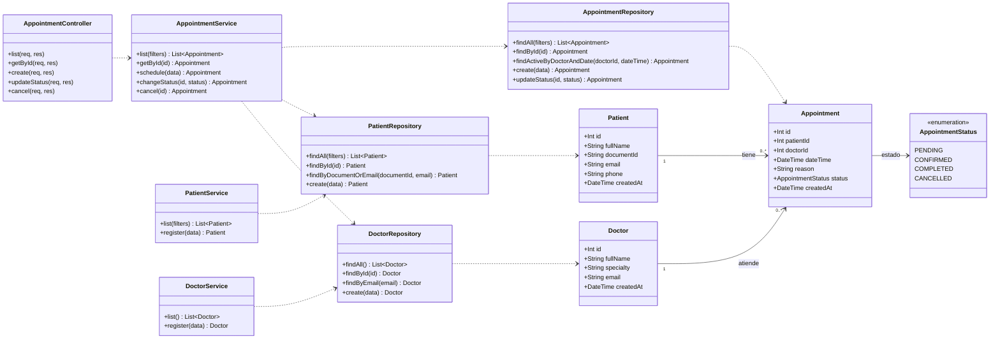
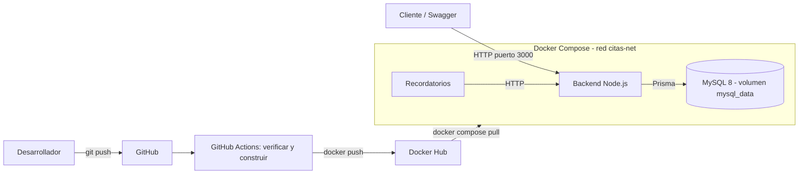

# API de Gestion de Citas Medicas

API REST para administrar pacientes, medicos y citas medicas. Hecha con Node.js (Express), MySQL y Prisma, organizada por capas y ejecutada con Docker Compose. Las imagenes se publican en Docker Hub con un pipeline de GitHub Actions.

## Tecnologias

- Backend: Node.js 20 y Express
- Base de datos: MySQL 8
- ORM: Prisma
- Validacion: Zod
- Documentacion de la API: Swagger (OpenAPI)
- Contenedores: Docker y Docker Compose
- Registro de imagenes: Docker Hub
- CI/CD: GitHub Actions

## Arquitectura

Arquitectura por capas dentro de una aplicacion monolitica:

    Cliente -> Rutas -> Validacion -> Controlador -> Servicio -> Repositorio -> MySQL (Prisma)

Se eligio porque el sistema es pequeno o mediano, con operaciones CRUD y pocas reglas de negocio. Es simple de mantener, de probar y de desplegar, sin la complejidad de los microservicios.

## Estructura de carpetas

```
citas-api/
|-- .github/workflows/ci.yml     Pipeline CI/CD
|-- prisma/
|   |-- schema.prisma            Modelos Patient, Doctor y Appointment
|   `-- migrations/              Historial de migraciones
|-- recordatorios/               Segundo servicio (imagen propia)
|   |-- Dockerfile
|   `-- index.js
|-- src/
|   |-- config/prisma.js         Instancia unica de Prisma Client
|   |-- controllers/             Reciben la peticion y devuelven la respuesta
|   |-- docs/openapi.js          Documentacion Swagger
|   |-- middlewares/             Validacion, 404 y manejo de errores
|   |-- repositories/            Acceso a datos (unico lugar con Prisma)
|   |-- routes/                  Definicion de endpoints
|   |-- services/                Logica de negocio
|   |-- utils/                   AppError y asyncHandler
|   |-- validators/              Esquemas de Zod
|   |-- app.js                   Configuracion de Express
|   `-- server.js                Arranque del servidor
|-- .dockerignore
|-- .env.example                 Plantilla de variables de entorno
|-- .gitignore
|-- Dockerfile                   Imagen del backend
|-- docker-compose.yml           Orquestacion de los servicios
|-- package.json
|-- requests.http                Ejemplos de peticiones
`-- README.md
```

## Responsabilidad de cada capa

| Capa | Responsabilidad |
|---|---|
| Rutas | Definen los endpoints y los enlazan con su validador y su controlador |
| Validadores | Revisan que los datos de entrada sean correctos (Zod) |
| Controladores | Reciben la peticion HTTP, llaman al servicio y responden con el codigo HTTP adecuado. No tienen logica de negocio |
| Servicios | Reglas de negocio: que el paciente y el medico existan, que no haya citas simultaneas y que los cambios de estado sean validos |
| Repositorios | Acceso a datos. Son los unicos que usan Prisma Client |
| Middlewares | Validacion generica, rutas inexistentes (404) y manejo centralizado de errores |

## Modelo de datos

Los modelos estan en ingles en el codigo, pero las tablas y columnas de MySQL quedan en espanol (`@map` y `@@map` de Prisma).

| Tabla | Columnas principales |
|---|---|
| pacientes | id (PK), nombre_completo, documento_identificacion (unico), correo (unico), telefono |
| medicos | id (PK), nombre_completo, especialidad, correo (unico) |
| citas | id (PK), paciente_id (FK), medico_id (FK), fecha_hora, motivo, estado |

Relaciones: un paciente y un medico pueden tener muchas citas (1 a N). Cada cita pertenece a un solo paciente y a un solo medico. Estados de la cita: PENDING, CONFIRMED, COMPLETED y CANCELLED.

## Endpoints

| Metodo | Ruta | Descripcion | Codigos |
|---|---|---|---|
| POST | /patients | Registrar paciente | 201, 400, 409 |
| GET | /patients | Listar pacientes (filtros: name, documentId) | 200 |
| POST | /doctors | Registrar medico | 201, 400, 409 |
| GET | /doctors | Listar medicos | 200 |
| POST | /appointments | Programar cita | 201, 400, 404, 409 |
| GET | /appointments | Listar citas (filtros: date, status, patientId, doctorId) | 200, 400 |
| GET | /appointments/:id | Consultar una cita | 200, 400, 404 |
| PATCH | /appointments/:id/status | Actualizar el estado | 200, 400, 404, 409 |
| DELETE | /appointments/:id | Cancelar (cancelacion logica, conserva el historial) | 200, 404, 409 |
| GET | /health | Verificar que la API responde | 200 |

Documentacion interactiva con Swagger en http://localhost:3000/docs

Cambios de estado permitidos: PENDING a CONFIRMED o CANCELLED, y CONFIRMED a COMPLETED o CANCELLED.

## Reglas de negocio y validaciones

- Una cita debe tener paciente, medico y fecha y hora validos. Si faltan datos responde 400.
- No se puede programar una cita en una fecha pasada (400).
- Si el paciente o el medico no existen responde 404.
- Un medico no puede tener dos citas activas a la misma hora (409). Una cita cancelada libera el horario.
- No se pueden repetir el documento o el correo de un paciente, ni el correo de un medico (409).

## Contenedores (Docker Compose)

| Servicio | Imagen | Funcion |
|---|---|---|
| backend | edosebas/citas-backend (propia) | Expone la API REST, aplica las reglas de negocio y usa Prisma para acceder a MySQL |
| recordatorios | edosebas/citas-recordatorios (propia) | Servicio independiente que consulta al backend las citas activas de las proximas horas y genera un recordatorio para el paciente |
| db | mysql:8.0 (oficial) | Guarda pacientes, medicos y citas |

- Los tres contenedores estan en la red `citas-net`. El backend se conecta a MySQL con el nombre `db`, y recordatorios habla con el backend por HTTP en `http://backend:3000`.
- Los datos de MySQL se guardan en el volumen `mysql_data`, asi que se conservan si se elimina el contenedor.
- `db` tiene un healthcheck, y el backend solo arranca cuando MySQL esta sano. Ademas reintenta las migraciones hasta que MySQL responde.

## Imagenes en Docker Hub

- https://hub.docker.com/r/edosebas/citas-backend
- https://hub.docker.com/r/edosebas/citas-recordatorios

Cada imagen tiene dos etiquetas: la version (`1.0.0`) o el identificador corto del commit (lo publica el pipeline), y `latest`.

## Como ejecutar el proyecto

### Con Docker Compose (usa las imagenes publicadas)

1. Copiar la plantilla de variables: `copy .env.example .env`
2. Editar `.env` y poner una contrasena en `MYSQL_ROOT_PASSWORD`.
3. Levantar todo: `docker compose up -d`
4. Abrir http://localhost:3000/docs

Comandos utiles:

```
docker compose ps          Ver el estado de los servicios
docker compose logs backend
docker compose logs recordatorios
docker compose stop        Detener
docker compose start       Volver a iniciar
docker compose down        Eliminar contenedores (los datos se conservan)
docker compose up -d --build   Reconstruir (si se usa build en vez de image)
```

### En desarrollo local

1. Tener Node.js 18 o superior y un MySQL en funcionamiento.
2. Copiar `.env.example` como `.env` y poner la contrasena real en `DATABASE_URL`.
3. `npm install`
4. `npx prisma migrate dev --name init`
5. `npm run dev`

## Pipeline CI/CD

El archivo `.github/workflows/ci.yml` se ejecuta con cada `push` y cada `pull request` hacia `main`:

1. Instalar y verificar: instala Node.js 20 y las dependencias, revisa la sintaxis de todo el codigo (`node --check`) y valida el esquema de Prisma.
2. Construir y publicar imagenes: construye las imagenes de backend y recordatorios. Solo se publican en Docker Hub cuando el evento es un `push` a `main`, etiquetadas con el commit y con `latest`.

## Gestion de credenciales

- El archivo `.env` no se sube a GitHub (esta en `.gitignore`) ni se copia dentro de las imagenes (esta en `.dockerignore`).
- El repositorio solo incluye `.env.example`, con valores de ejemplo.
- La contrasena de MySQL llega a los contenedores como variable de entorno desde `.env`.
- El pipeline se autentica en Docker Hub con los secretos `DOCKERHUB_USERNAME` y `DOCKERHUB_TOKEN` de GitHub, con un token de acceso (no la contrasena de la cuenta).

## Diagramas UML

### Diagrama de clases



Los controladores de pacientes y medicos siguen el mismo patron que el de citas.

Relacion con las capas: las entidades (Patient, Doctor, Appointment) corresponden a los modelos de `schema.prisma`; los repositorios son la capa de acceso a datos; los servicios, la logica de negocio; y los controladores, la capa de presentacion.

### Diagrama de arquitectura y despliegue


